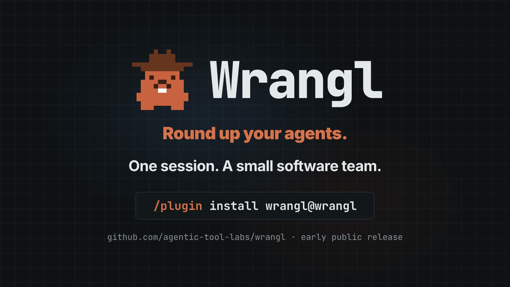

# Wrangl: Agent Hierarchy


Wrangl is a Claude Code plugin that turns one Claude Code session into a small software team. Your session becomes the
Orchestrator: it splits a job into pieces and hands each piece to a specialist, such as an Architect, an Implementor or
a Reviewer. A small background program on your machine carries the messages between them. The commands are `ah` and
`ahd`.

[](https://agentic-tool-labs.github.io/wrangl/#reel-title)

> [!WARNING]
> **Early testing: use with caution.** Wrangl 2.0.55 is an early public release and is still being tested. It starts
> and controls other agent sessions that edit files and run commands in your repository, so use it only on work you
> have committed or backed up. Expect bugs, and expect commands, settings and screens to change between releases.
> Wrangl is provided "as is", without warranties of any kind; see the [LICENSE](LICENSE). Report problems at
> <https://github.com/agentic-tool-labs/wrangl/issues>, with the output of `ah roster doctor --brief`.

## Install

You need macOS or Linux, Claude Code 2.1.289 or later, a .NET 10 SDK (the installer offers to install one if you
have none) and a C toolchain. [What you need](agent-hierarchy-v2/README.md#what-you-need) has the details. If you
use the older `ah` plugin (v1), run `/plugin disable ah@agent-tools` in Claude Code first.

**1. Install.** In a terminal:

```
curl -fsSL https://raw.githubusercontent.com/agentic-tool-labs/wrangl/main/install.sh | bash
```

It shows its plan and asks before it changes anything. It installs the `wrangl` plugin into Claude Code and builds
the `ah` and `ahd` commands. Piping a script into `bash` runs code you have not read. To read it first:

```
curl -fsSL https://raw.githubusercontent.com/agentic-tool-labs/wrangl/main/install.sh -o wrangl-install.sh
less wrangl-install.sh
bash wrangl-install.sh
```

Prefer to do it by hand? Inside Claude Code:

```
/plugin marketplace add agentic-tool-labs/wrangl
/plugin install wrangl@wrangl
/wrangl:hierarchy install
```

**2. Turn it on.** Inside Claude Code:

```
/wrangl:hierarchy init
```

Then run `/clear`, or start a new session.

**3. Check it.** In a terminal, inside your repository:

```
ah roster doctor --brief
```

No line should start with `red`; a `red` line names its own fix.

The [full install guide](agent-hierarchy-v2/README.md#install) covers each step, what you should see, managed
Claude Code, the herdr desktop app and how to uninstall. [Getting started](agent-hierarchy-v2/docs/getting-started.md)
takes you from here to a working team.

## Documentation

- [Plugin README](agent-hierarchy-v2/README.md): what Wrangl is, the roles, install and a quick start
- [Getting started](agent-hierarchy-v2/docs/getting-started.md): from nothing to a running team
- [How it works](agent-hierarchy-v2/docs/how-it-works.md): the ideas behind it
- [CLI reference](agent-hierarchy-v2/docs/cli-tools.md): every `ah` and `ahd` command
- [Troubleshooting](agent-hierarchy-v2/docs/troubleshooting.md): symptoms and fixes
- [Glossary](agent-hierarchy-v2/docs/glossary.md): the words Wrangl uses
- [Changelog](agent-hierarchy-v2/CHANGELOG.md)

## License

Apache-2.0. See [LICENSE](LICENSE).
